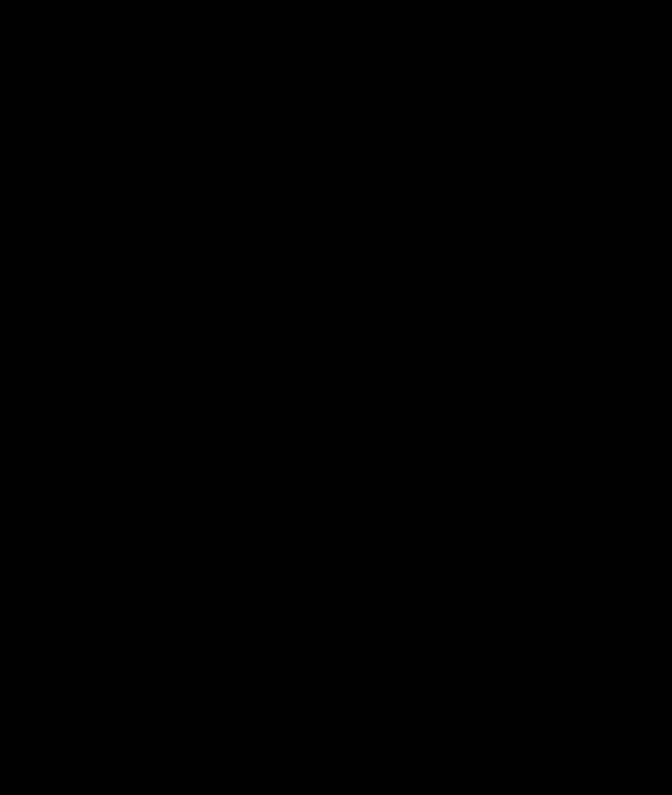
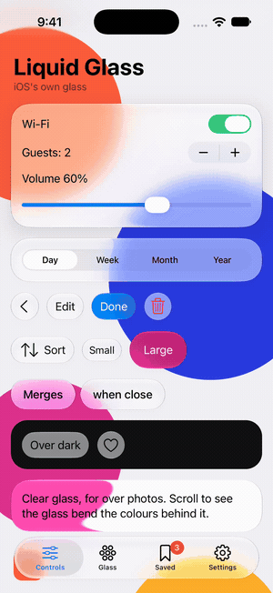
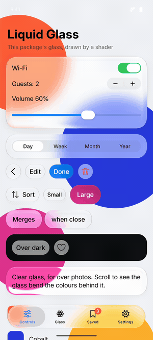

<div align="center">

# liquidglass

### Apple's iOS 27 Liquid Glass for React and React Native

Glass that bends the light behind it, and the iOS controls built from it,<br>
measured against the real thing on the iOS simulator.

[](https://www.npmjs.com/package/@onlymoein/liquidglass)
[](https://www.npmjs.com/package/@onlymoein/liquidglass-native)
[](#performance)
[](https://www.npmjs.com/package/@onlymoein/liquidglass)
[](LICENSE)

**[Live demo](https://onlymoein.github.io/liquidglass/)** · **[Web quick start](#react-for-the-web)** · **[React Native quick start](#react-native-and-expo)** · **[Components](#components)** · **[FAQ](#faq)**

<table>
  <tr>
    <td align="center"><a href="https://github.com/onlymoein/liquidglass/blob/main/assets/liquidglass-v0.10-parity.mp4"></a></td>
    <td align="center"><a href="https://github.com/onlymoein/liquidglass/blob/main/native/assets/demo-ios.mp4"></a></td>
    <td align="center"><a href="https://github.com/onlymoein/liquidglass/blob/main/native/assets/demo-android.mp4"></a></td>
  </tr>
  <tr>
    <td align="center"><b>Web</b><br><sub>real iOS 27 left, liquidglass right</sub></td>
    <td align="center"><b>React Native, iOS</b><br><sub>Apple's own glass</sub></td>
    <td align="center"><b>React Native, Android</b><br><sub>drawn to iOS's measurements</sub></td>
  </tr>
</table>

</div>

## Why liquidglass

- **One API for web and mobile.** `Button`, `Switch`, `Slider`, `Menu`, `TabBar` and the rest have the same names and props in React and React Native.
- **Measured, not eyeballed.** The repo runs real iOS controls and this library side by side on the simulator and measures the difference. In Chrome, glass colour is within 2 levels out of 255 of iOS.
- **The real thing on iPhone.** In React Native on iOS, the components are Apple's own UIKit glass and controls. On Android, the package draws the glass itself, to the same measurements.
- **Moves like iOS.** Presses, menus, sheets and the tab bar's lens are on springs fitted to recordings of iOS 27.
- **Light on the page.** The glass is worked out in a Web Worker, so the page isn't held up. One `Button` is about 12 kB, and bundlers drop the rest. The demo scores 99 on Lighthouse mobile.
- **Accessible.** Keyboard and screen-reader support throughout. Glass turns fully tinted when the system is set to reduce transparency or increase contrast.
- **Ready for AI coding agents.** [One command](#for-coding-agents) teaches Claude Code, Cursor or Codex the whole library.

## Quick start

| You're building | Package | Runs on |
| --- | --- | --- |
| A website or web app (React, Next.js, Vite, Remix) | [`@onlymoein/liquidglass`](https://www.npmjs.com/package/@onlymoein/liquidglass) | Chrome, Edge, Safari, Firefox |
| A mobile app (React Native, Expo) | [`@onlymoein/liquidglass-native`](https://www.npmjs.com/package/@onlymoein/liquidglass-native) | iOS and Android |

### React for the web

```bash
npm install @onlymoein/liquidglass
```

```tsx
import { Button, Glass, Switch } from "@onlymoein/liquidglass";

export function Settings() {
  return (
    <Glass style={{ borderRadius: 28, padding: 20 }}>
      <Switch aria-label="Wi-Fi" defaultChecked />
      <Button variant="filled">Continue</Button>
    </Glass>
  );
}
```

There's no other setup: each component brings its own CSS the first time it renders. It needs React 18 or later. Put glass over a photo, a gradient or content that scrolls, since glass shows what's behind it.

### React Native and Expo

```bash
npx expo install @onlymoein/liquidglass-native expo-glass-effect
npx expo run:ios   # or run:android
```

```tsx
import { Button, Glass, Slider, Switch } from "@onlymoein/liquidglass-native";

export function Player() {
  return (
    <Glass style={{ padding: 16, borderRadius: 28, gap: 12 }}>
      <Switch defaultChecked />
      <Slider defaultValue={0.5} />
      <Button label="Done" variant="filled" onPress={() => {}} />
    </Glass>
  );
}
```

It needs Expo SDK 54 or later and a development build; it doesn't run in Expo Go. On Android, wrap what the glass should show in a `Backdrop`. The full guide is in the **[React Native README](native/)**.

## Components

| Component | What it is | Web | React Native |
| --- | --- | :---: | :---: |
| `Glass` | A plain piece of glass to put anything on | ✓ | ✓ |
| `GlassGroup` | Glass that flows together when pieces come close | ✓ | ✓ |
| `Button` | A glass or filled button in the iOS sizes, with an optional icon or tint | ✓ | ✓ |
| `Switch` | An on/off switch with a glass thumb | ✓ | ✓ |
| `Slider` | A slider with a glass thumb | ✓ | ✓ |
| `Stepper` | Two buttons that step a number down and up | ✓ | ✓ |
| `SegmentedControl` | A row of choices with a thumb that lifts into a lens under a finger | ✓ | ✓ |
| `Menu` | A menu that grows out of its button | ✓ | ✓ |
| `TabBar` | Tabs with a lens that follows the finger | ✓ | ✓ |
| `Toolbar`, `ToolbarGroup` | A bar of actions that frosts as content scrolls under it | ✓ | |
| `NavigationBar` | A screen's top bar: back button, actions, a large title that slides into the bar | ✓ | |
| `Input`, `SearchField` | Text fields set in glass | ✓ | |
| `ContextMenu` | A menu that opens when you hold something down or right-click it | ✓ | |
| `Sheet` | A sheet that rises from the bottom and drags between heights | ✓ | |
| `Alert` | A modal question with pill buttons | ✓ | |
| `PageControl` | Page dots on a capsule of glass | ✓ | |
| `Progress`, `Spinner` | A progress bar and the activity indicator | ✓ | |
| `Backdrop`, `Text`, `ScrollView` | What glass shows on Android, an iOS-like typeface, and iOS's bounce | | ✓ |

Every control can be **controlled** (`value` / `checked` / `open` with `onValueChange` / `onCheckedChange` / `onOpenChange`) or **uncontrolled** (`defaultValue` / `defaultChecked` / `defaultOpen`).

<details>
<summary><b>Web components in detail</b>: Toolbar, NavigationBar, Menu, Sheet, Alert, TabBar, GlassGroup</summary>

#### Toolbar

```tsx
import { Button, Toolbar, ToolbarGroup } from "@onlymoein/liquidglass";

<Toolbar aria-label="Notes">
  <ToolbarGroup aria-label="Navigation">
    <Button>Back</Button>
  </ToolbarGroup>
  <ToolbarGroup aria-label="Actions">
    <Button>Share</Button>
    <Button>Edit</Button>
  </ToolbarGroup>
</Toolbar>
```

Put it first inside whatever scrolls; it sticks to the top. Buttons in one group share a piece of glass. When content scrolls under the bar, a frosted band fades in, as on iOS 27. Use `edge="soft"` for iOS 26's lighter blur, or `edge="none"` for neither. The arrow keys move between actions.

#### NavigationBar

```tsx
import { Button, NavigationBar, ToolbarGroup } from "@onlymoein/liquidglass";

<NavigationBar
  title="Inbox"
  onBack={goBack}
  trailing={
    <ToolbarGroup aria-label="Actions">
      <Button aria-label="Compose" icon={<ComposeIcon />} />
    </ToolbarGroup>
  }
/>
```

A `Toolbar` with a title. The title starts large and scrolls away with the content, and a smaller one fades into the bar once it's gone. `large={false}` keeps the small title from the start. `onBack` adds the round back button, and `leading` and `trailing` hold other actions.

#### Menu

```tsx
import { Menu } from "@onlymoein/liquidglass";

<Menu
  aria-label="Account"
  label="Account"
  items={[
    { heading: "Appearance" },
    { label: "Light", checked: theme === "light", keepOpen: true, onSelect: () => setTheme("light") },
    { label: "Dark", checked: theme === "dark", keepOpen: true, onSelect: () => setTheme("dark") },
    "separator",
    { label: "Sign out", destructive: true, onSelect: signOut },
  ]}
/>
```

- With a `label` the trigger is a pill, like iOS's pull-down button. Without one it's a round button with an ellipsis or your `icon`.
- `align` lines the menu up with the trigger's `start`, `center` or `end`. `trigger` passes props to the trigger button, such as `{ variant: "filled" }`.
- An item with `href` is a link: `onSelect` runs instead if it's given, for your router, and ⌘, Ctrl, Shift or the middle button opens a new tab.
- `checked` shows a checkmark, and `keepOpen` leaves the menu open so the change can be seen.
- It opens in the top layer, so nothing around the trigger can clip it.

#### Sheet and Alert

```tsx
import { Alert, Sheet } from "@onlymoein/liquidglass";

<Sheet aria-label="Details" open={open} onOpenChange={setOpen}>
  {details}
</Sheet>

<Alert
  open={asking}
  onOpenChange={setAsking}
  title="Delete shipment?"
  message="This can't be undone."
  actions={[{ label: "Cancel", role: "cancel" }, { label: "Delete", role: "destructive", onSelect: remove }]}
/>
```

A sheet rests at half height as floating glass, and at full height as an opaque panel. `detents` chooses which heights it has. Drag it from anywhere, not just the handle. Scrolling content inside it hands drags back and forth as on iOS. Drags that start on a slider, a text field or anything marked `data-lg-no-sheet-drag` stay with that element.

#### TabBar

Give items an `icon` for the 62-point iOS tab bar. `minimized` shrinks it to the current tab's icon, as iOS does when a page scrolls down, and `onExpand` tells you when that icon is tapped. Items with an `href` render through `link`, such as Next.js's `Link`.

#### GlassGroup

```tsx
import { Button, GlassGroup } from "@onlymoein/liquidglass";

<GlassGroup spacing={20} style={{ gap: 6 }}>
  <Button aria-label="Add" icon={<PlusIcon />} />
  <Button aria-label="Edit" icon={<PencilIcon />} />
</GlassGroup>
```

Glass closer together than `spacing` becomes one shape, and parts again as it moves away.

#### Popups from other libraries

Add the class `lg-grow` to a popup from Radix, Base UI or similar. It then grows out of its `transform-origin` on `data-open` and shrinks away on `data-closed`, with the menu's spring.

</details>

<details>
<summary><b>Theming</b>: light and dark, transparency, colours</summary>

**Light and dark** follow the system. To pin one, set `data-theme="light"` or `data-theme="dark"` on any element.

**Transparency** works like the iOS 27 setting. `--lg-transparency` runs from `0` (fully tinted) through `0.5` (regular, the default) to `1` (clear). Set it anywhere and the glass inside follows. If someone's system is set to reduce transparency or increase contrast, glass is fully tinted, as on iOS.

```css
:root {
  --lg-transparency: 0.8;
}
```

**Colours** are CSS variables you can override:

| Variable | What it sets |
| --- | --- |
| `--lg-fill` | The accent colour of filled buttons and sliders |
| `--lg-on` | A switch that's on |
| `--lg-glass-tinted` | The tint when `--lg-transparency` is below `0.5` |
| `--lg-shine` | How strong the rim's lines are; `1` matches iOS 27 |
| `--lg-contrast`, `--lg-brightness`, `--lg-saturate` | What glass does to what's behind it (add `-small` for glass 60 points tall or less) |

</details>

## Browser support

| Browser | Colour, blur and rim | Edge bends like iOS |
| --- | :---: | :---: |
| Chrome, Edge and other Chromium browsers | ✓ | ✓ |
| Safari (Mac, iPhone, iPad) | ✓ | |
| Firefox | ✓ | Over content you mark |

Only Chromium lets a page bend what's behind an element. Everywhere else the glass looks the same, but its edge doesn't bend. In Firefox, add `data-liquidglass-backdrop` to a wallpaper or hero image behind the glass, and the glass bends a copy of it. Keep it to a small area, since everything inside it is copied for every piece of glass over it.

```tsx

```

## Performance

- The lens maps and rims are drawn in a Web Worker, off the page's thread. Glass is frosted at once and picks up its lens a moment later.
- Maps are freed once no glass uses them, so resizing doesn't pile them up.
- One `Button` adds about 12 kB to a site, minified and compressed; everything together is about 31 kB. Bundlers drop what you don't use.
- Every pull request checks bundle size (`npm run size`), Lighthouse (`npm run perf:lighthouse`) and dropped frames while scrolling and resizing (`npm run perf:frames`).
- **Content Security Policy:** allow `worker-src blob:` and `img-src blob: data:`.

## For coding agents

An agent skill teaches Claude Code, Cursor, Codex and other agents both packages: the components, theming, browser differences and what to check when glass looks wrong.

```bash
npx skills add onlymoein/liquidglass
```

It also ships in the web package, at `node_modules/@onlymoein/liquidglass/skills/liquidglass/SKILL.md`.

## FAQ

**Does it work in Next.js?**
Yes. The components are client components, so you can import them from server component files. Their styles are added on the client.

**Why doesn't the edge bend in Safari?**
Safari doesn't let a web page filter what's behind an element. The glass has the same colour, blur and rim there; only the bend is missing.

**My glass is invisible or plain grey.**
Glass needs something colourful behind it. Also check its ancestors: one with `opacity` below 1, `filter`, `mask` or `backdrop-filter` limits the glass to what's inside that ancestor. Glass nested in other glass has the same problem.

**Does the React Native package work in Expo Go?**
No. It has native code, so it needs a development build (`npx expo run:ios`) or EAS Build.

**What about Android?**
Android has no Liquid Glass, so the package draws its own to iOS's measurements. It bends from Android 13, and is blurred and toned without the bend before that. See [Android](native/#android).

**I used glisse.**
liquidglass started as a fork of [glisse](https://github.com/0kzh/glisse) by Kelvin Zhang, and the components and props are the same. Change your imports, and rename `data-glisse-backdrop` to `data-liquidglass-backdrop`. If you set `--lg-glass`, set `--lg-glass-tinted` and `--lg-transparency` instead.

## License

MIT. Copyright Kelvin Zhang and Moein Saharkhiz.

liquidglass is an independent project. It isn't affiliated with or endorsed by Apple. Apple, iOS and Liquid Glass are trademarks of Apple Inc.

<div align="center">
<sub>If liquidglass saves you time, a ⭐ helps others find it.</sub>
</div>
