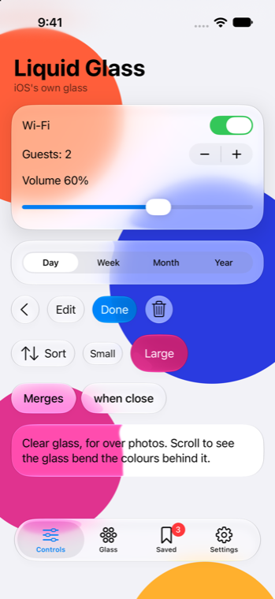
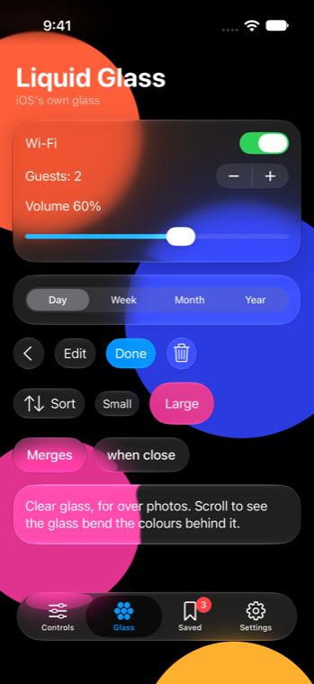
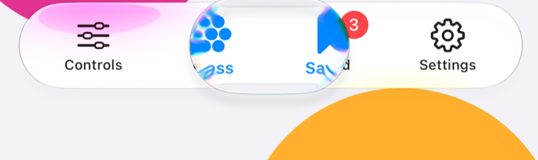
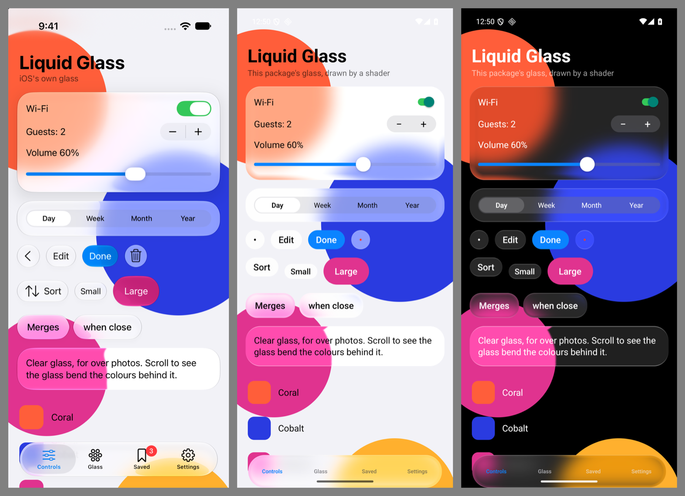

# liquidglass for React Native

Apple's iOS 27 Liquid Glass for React Native and Expo, with the same component names as [liquidglass for the web](https://github.com/onlymoein/liquidglass).

On iOS 26 and later the components are UIKit's own controls and glass, so iOS draws them itself. The glass bends what's behind it, the controls swell when pressed, and a held tab bar shows Apple's lens. It all matches Apple's apps because it is Apple's.

<table>
  <tr>
    <td align="center" width="50%"></td>
    <td align="center" width="50%"></td>
  </tr>
  <tr>
    <td colspan="2" align="center"><br>Holding the tab bar, on iOS 27.</td>
  </tr>
</table>

## Install

In an Expo app (SDK 58 or later):

```sh
npx expo install @onlymoein/liquidglass-native expo-glass-effect
npx expo run:ios
```

The package includes native code, so it needs a development build (`npx expo run:ios`, or EAS Build). It doesn't run in Expo Go. In a bare React Native app, install [Expo Modules](https://docs.expo.dev/bare/installing-expo-modules/) first.

## Use

```tsx
import { Button, Glass, Slider, Switch, TabBar } from '@onlymoein/liquidglass-native';
import { useState } from 'react';
import { View } from 'react-native';

export function Player() {
  const [tab, setTab] = useState('home');
  const [volume, setVolume] = useState(0.5);
  return (
    <>
      <Glass style={{ padding: 16, borderRadius: 28, gap: 12 }}>
        <Switch defaultChecked onCheckedChange={(on) => console.log(on)} />
        <Slider value={volume} onValueChange={setVolume} />
        <Button label="Done" variant="filled" onPress={() => console.log('done')} />
      </Glass>
      <View style={{ position: 'absolute', left: 0, right: 0, bottom: 0 }}>
        <TabBar
          items={[
            { value: 'home', label: 'Home', icon: 'house', selectedIcon: 'house.fill' },
            { value: 'search', label: 'Search', icon: 'magnifyingglass' },
          ]}
          value={tab}
          onValueChange={setTab}
        />
      </View>
    </>
  );
}
```

Icons are [SF Symbols](https://developer.apple.com/sf-symbols/) names, such as `"house.fill"`.

Controls size themselves the way UIKit sizes them. A slider, segmented control or tab bar fills the width it's given.

Put the tab bar at the very bottom of the screen, as above. It leaves room for the home indicator itself.

## Components

| Component | What it is on iOS |
| --- | --- |
| `Glass` | A pane of glass, `regular` or `clear`, optionally `tint`ed or `interactive` |
| `GlassGroup` | Glass inside it flows together when shapes come within `spacing` |
| `Backdrop` | What glass shows on Android; a plain view on iOS and the web. See [Android](#android) |
| `Button` | A glass button, or `variant="filled"` for the primary action; `small`, `regular` or `large` |
| `Menu` | A button that opens iOS's glass menu, with icons, checkmarks and destructive items |
| `Switch` | `UISwitch` |
| `Slider` | `UISlider`, with `step` |
| `Stepper` | `UIStepper` |
| `SegmentedControl` | `UISegmentedControl` |
| `TabBar` | The floating tab bar, with its lens, badges and selected icons |

Each control works controlled (`value` / `checked`) or uncontrolled (`defaultValue` / `defaultChecked`), as React's inputs do.

## Android

Android has no Liquid Glass of its own, so the package draws it. Glass shows what's behind it bent at the rim, blurred, lifted and saturated, with a lit hairline along its top and bottom, following the same optics as the web version.



An Android view can't see what's drawn behind it, so glass there shows what's inside a `Backdrop`. Wrap what the glass should show, and keep the glass itself outside it:

```tsx
<Backdrop style={{ flex: 1 }}>
  <ScrollView>{/* the page */}</ScrollView>
</Backdrop>
<TabBar items={tabs} />{/* shows the page, as it's outside the Backdrop */}
```

Glass uses the nearest `Backdrop` drawn before it, as a sibling of the glass or of one of its parents. Give the backdrop a background colour, which is what glass shows where nothing is drawn. On iOS and the web a `Backdrop` is a plain view, so the same code works everywhere.

- **Android 13 and later:** the full glass.
- **Android 12:** blur and tone, without the bend.
- **Android 11 and earlier:** a translucent pane.

The controls on Android are still plain, apart from glass behind the buttons and the tab bar. Native Android versions of the switch, slider, segmented control and tab bar, with the held lens, come next. So does the merging of nearby glass in `GlassGroup`.

## Other platforms

- **iOS 25 and earlier:** the controls are the system's ordinary ones, and `Glass` is a translucent pane.
- **Web:** plain stand-ins for now. For a web app, use [liquidglass for the web](https://github.com/onlymoein/liquidglass).

## Example app

```sh
cd native && npm install && npm run build
cd example && npm install && npx expo run:ios   # or run:android
```

## License

MIT
